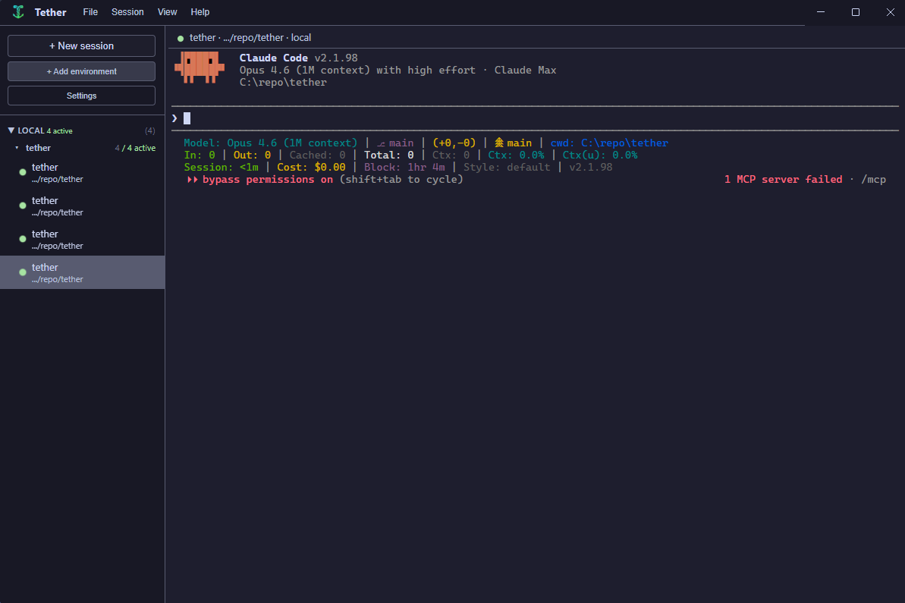

<p align="center">
  
</p>

<h1 align="center">Tether</h1>

<p align="center">
  A desktop session multiplexer for <a href="https://docs.anthropic.com/en/docs/claude-code">Claude Code</a>, Codex CLI, and other agent CLIs.<br/>
  Manage multiple sessions across local, SSH, and Coder workspace environments — with the full native terminal experience.
</p>

<p align="center">
  <a href="LICENSE"></a>
  
  <a href="https://github.com/maxthomas95/tether/releases/latest"></a>
  <a href="https://sonarcloud.io/summary/new_code?id=maxthomas95_tether"></a>
  <a href="https://sonarcloud.io/summary/new_code?id=maxthomas95_tether"></a>
  <a href="https://sonarcloud.io/summary/new_code?id=maxthomas95_tether"></a>
  <a href="https://sonarcloud.io/summary/new_code?id=maxthomas95_tether"></a>
</p>

<p align="center">
  <a href="https://tethercli.app"><strong>tethercli.app</strong></a> ·
  <a href="https://github.com/maxthomas95/tether/releases">Download</a> ·
  <a href="docs/ARCHITECTURE.md">Architecture</a> ·
  <a href="ROADMAP.md">Roadmap</a>
</p>

<p align="center">
  
</p>

---

## Download

Download the [latest stable Windows release](https://github.com/maxthomas95/tether/releases/latest). The v0.7.0 milestone brings together the changes tested on the 0.6.x beta train; see the [changelog](CHANGELOG.md) for the overview and upgrade notes. Beta builds remain on the [Releases page](https://github.com/maxthomas95/tether/releases).

- **Setup installer** — `Tether-x.y.z-Setup.exe` (recommended)
- **Portable zip** — `Tether-x.y.z-portable.zip` (no install required)

Windows builds are currently unsigned. Install and authenticate your chosen CLI separately. The app includes its Electron runtime; optional CLI hooks, Helm, and automatic J.O.B.S. launch also need standalone Node.js on PATH. Building from source requires Node 24. Linux and macOS desktop builds are planned after 1.0.

## Core Principle

> **Dumb pipe, smart shell.** Never parse, intercept, or re-render CLI output. The PTY stream flows untouched into xterm.js. Status detection is a passive side-channel tap, not an interceptor.

## Why?

Agent CLIs are powerful, but managing multiple sessions across environments is painful:

- Sessions scattered across terminals, tmux panes, SSH connections, and container shells
- Context switching means remembering which tab has which repo on which machine
- Recovering conversation context after a disconnect requires finding the right saved session
- Tools that parse and re-render CLI output break the native experience

Tether gives you a **single window** with a sidebar to manage it all — while every session stays a real PTY piped byte-for-byte into xterm.js. Claude Code and Codex CLI do not know they are being managed.

## Features

### Sessions

- **Multiple concurrent sessions** with instant switching — click in the sidebar, or `Ctrl+1`–`Ctrl+9`
- **Session grouping** by environment and working directory; collapsible groups, **drag-reorder** inside a group
- **Bulk group actions** — Stop all / Restart all / Clear all per repo group from a right-click menu
- **Split panes** *(experimental)* — drag from the sidebar into drop zones to view sessions side-by-side; keyboard-driven focus (`Alt+Arrow`) and swap (`Alt+Shift+Arrow`); broadcast input to multiple panes; in-pane recovery overlay when a session dies
- **Canvas layout** *(experimental)* — arrange movable, resizable session panels, pan across larger workspaces, and retain their arrangement when switching layouts
- **Workspace recipes** — save named session groups and layouts, then reopen selected slots with edited paths or remapped environments; opening a recipe starts fresh sessions and leaves existing ones running
- **Navigation and visibility** — `Ctrl+P` session search, an attention queue, local repository branch/dirty badges, and terminal hover previews
- **Child-agent visibility** — Claude subagent rows for local, SSH, and Coder sessions, with status, model, timing, tokens, and a read-only transcript viewer. Trusted, opted-in local Codex lifecycle hooks also show `codex exec` runs launched by Claude
- **Desktop notifications** — configurable alerts for waiting, idle, unexpected exit, and terminal bell; per-session mute toggle with 🔕 badge; suppresses when focused
- **Status indicators** — green (running), amber (waiting), gray (idle), red (dead) — passive PTY tap, no ANSI parsing; optional CLI hook integration for higher-fidelity detection
- **Workspace persistence** — sessions save on quit and restore on launch; writes are atomic (tmp → fsync → rename)
- **Saved launch settings** — encrypted session overrides and launch-profile references survive restore and duplication; remote Claude/Codex restart resumes a known conversation when its history is available, without reattaching the original process
- **Resume previous chats** — pick up a prior Claude Code, Codex CLI, OpenCode, or Copilot CLI transcript on session create
- **First-run Setup Wizard** — guided setup for projects, theme, Vault, environments, CLI defaults, CLI status hooks, notifications, and Git providers

### Environments

- **Local, SSH, and Coder** — `node-pty` locally, `ssh2` for remote, Coder REST + `coder ssh` PTY for workspaces (including creating new workspaces from templates with parameter forms and live build progress)
- **SSH host key verification** — TOFU pinning on first connect, managed known-hosts in Settings
- **Env var cascade** — app defaults → environment → launch profile → session overrides, with presets for common Claude / Codex / Copilot vars
- **Launch profiles** — named env-var + CLI-flag presets for quick-switching between configurations
- **CLI flag management** — scoped per CLI tool (Claude, Codex, OpenCode, Copilot, Custom)

### Repo bootstrapping

- **Browse + clone** from GitHub, Azure DevOps, and Gitea inside the New Session dialog
- **New folder mode** — create an empty folder under your repos root, optionally `git init` and provision a matching empty remote on GitHub / ADO / Gitea, all in one dialog
- **Tether-managed worktrees** — create a git worktree at session start with optional cleanup on session removal

### Cost & quota

- **Usage tracking** — Claude Code and Codex CLI estimates cover local transcripts and Tether-launched SSH/Coder conversations, using a bundled [LiteLLM](https://github.com/BerriAI/litellm) pricing table. The OpenCode reader covers supported local Crush databases; other storage formats are not covered. Copilot has resume/history but no cost reader. Estimates are API-equivalent costs, not subscription bills. See [Usage & Quota](src/docs/usage-quota.md).
- **Usage history dialog** — project, environment, CLI, model and date filters, daily trends, period comparisons, and expandable session/model details
- **Budget warnings** — optional daily/weekly cost thresholds and Codex low-quota alerts; warnings do not enforce spending limits
- **CSV / JSON export** of usage history for offline analysis
- **Subscription quota tracking** *(optional)* — surface your Anthropic / OpenAI quota in the sidebar footer

### Secrets

- **Vault integration** — store secrets as `vault://mount/path#key` references resolved at session start; KV v2 with browser OIDC login, an encrypted token cache, expiry warnings, and a tree-view secret picker
- **Plaintext → Vault migration** — Settings has a one-click sweep that copies plaintext env-var values into Vault and rewrites the local config to references
- **Encrypted local state** — literal environment values, provider tokens, SSH passwords, secret settings, and saved launch overrides use OS-backed encryption; legacy credentials migrate before the database opens

### Interface

- **Customizable keyboard shortcuts** — every binding remappable in Settings, with a reserved-chord warn list for conflicts like `Ctrl+C`
- **Window zoom** — `Ctrl+=` / `Ctrl+-` / `Ctrl+0` zoom UI + terminal together; `Ctrl+scroll` resizes just one pane's terminal font
- **Font customization** — pick terminal font (Cascadia Code, JetBrains Mono, Fira Code, Consolas) and UI font (IBM Plex Sans, Inter, Atkinson Hyperlegible, System) independently
- **Terminal search** — search each pane's scrollback with next/previous, match-case, whole-word and regular-expression options
- **Clickable URLs** — `Ctrl+click` HTTP(S) URLs and OSC 8 hyperlinks, including Claude login links, to open them in the system browser
- **Clipboard and multiline input** — bracketed paste, write-only OSC 52 for remote clipboard copying, and per-CLI Windows Shift+Enter handling; hold Shift while dragging to select text in mouse-capturing full-screen CLIs
- **In-app documentation** with `(?)` deep-link icons that jump from dialogs straight to the relevant docs section
- **Eleven themes** — Catppuccin (Mocha, Macchiato, Frappé, Latte), Brass, Tether (Default Dark), Tether Light, Nord, Gruvbox Dark/Light, Harbor — applied everywhere including the title bar and docs window; bundled Iosevka Fixed and IBM Plex Mono terminal fonts with a live specimen preview

### Operations

- **Update notifications** — checks GitHub Releases on launch and links to downloads; stable/beta channels and an opt-out live in Settings → General
- **Diagnostics export** — one-click bundle of scrubbed `data.json` (SSH passwords, tokens, sensitive env-var values redacted) plus rotated logs, for triaging support issues
- **CLI maintenance** — check and update installed Claude Code, Codex CLI, and OpenCode tools on local, SSH, or Coder targets through temporary terminals
- **Optional sidebar companions** — local GIF panel and Pip pet, off by default. Pip's local reactions use status metadata; generated Codex quips and submitted-prompt sharing have separate opt-ins
- **J.O.B.S. Office** — optional external office view, off for new setups, with separate connection, remote-session sharing and automatic-launch controls
- **Helm** *(opt-in, personal-experimental)* — designate a session as "helm" so it can dispatch pre-briefed child sessions through the `tether-helm` MCP, including spawning Coder workspaces. Off by default behind a two-level gate. Not on the 1.0 roadmap.

> Features marked **experimental** are already useful, but may still have bugs, rough edges, or missing behavior. We label them clearly and keep iterating until they are stable.

### Supported CLI tools

Tether is a dumb-pipe PTY multiplexer for interactive coding CLIs. You can select a CLI tool per session:

- **Claude Code** (`claude`) — full support including session resume and transcript browsing
- **Codex CLI** (`codex`) — conversation resume, local transcript browsing, local/remote usage, and optional lifecycle visibility
- **GitHub Copilot CLI** (`copilot`) — session resume via `--resume`
- **OpenCode** (`opencode`) — session resume and transcript browsing support
- **Custom** — any binary you specify

Custom tools run as raw PTY sessions without tool-specific resume/history. The conversation picker is local-only. Saved-ID restart/restore supports remote Claude/Codex when the same user/home and history remain available; Codex needs its native ID captured before disconnect. Missing Claude history starts fresh under its saved ID. This restores context, not a surviving process. See [Sessions](src/docs/sessions.md#resume-conversation).

## Quick Start

Download a release (see above), or build from source:

```bash
npx npm@10.9.4 ci # Node 24; install locked dependencies
npm run start     # launch in dev mode (Electron Forge + Vite)
```

Use Node 24 and npm 10.9.4, matching CI. Run `npm run typecheck`, `npm run lint`, `npm test`, `npm run test:packaging`, and `npm run test:security` before submitting application changes. Packaging changes also need `npm run package` and `npm run verify:package`; `npm run make` produces the installer and portable zip. The Helm package has its own build and audit in CI. See [dependency security checks](docs/DEPENDENCY_SECURITY.md) for the integrity-checked build-only backport and strict runtime/Helm audits.

Use `npm run test:coverage` to generate application coverage and a local HTML report. CI publishes the report to SonarQube Cloud; see [coverage and Sonar setup](docs/SONAR.md) for scope and configuration.

## Tech Stack

| | Technology | Why |
|---|---|---|
| Shell | Electron 44 | Native window management, sandboxed preloads, context isolation |
| Frontend | React 19 + TypeScript | Component model, ecosystem |
| Terminal | xterm.js 6.0 | Full VT emulation — same engine as VS Code |
| Local PTY | node-pty | Real pseudo-terminal, same lib as VS Code |
| SSH | ssh2 | Pure JS SSH client with PTY channel support |
| Coder | Coder REST API + SSH PTY | Connect to or create Coder workspaces from templates |
| Secrets | HashiCorp Vault (KV v2) | Reference secrets via `vault://` instead of plaintext config |
| State | JSON file persistence | Embedded, zero-config |
| Build | Electron Forge + Vite | Fast dev server, optimized production builds |

## Network endpoints

Tether runs as a desktop client; outbound network traffic is intentionally minimal. If you're on a corporate network with egress filtering, the destinations below are what you'll need to allow.

| Destination | Purpose | Source |
|---|---|---|
| `api.github.com`, `github.com` | Auto-update check (latest GitHub Release polling) and downloading installers from the Releases page. | `src/main/update/update-checker.ts` |
| `raw.githubusercontent.com` | Daily refresh of LiteLLM model pricing JSON. Falls back to the bundled snapshot if blocked. | `src/main/usage/pricing-fetcher.ts` |
| Your Vault server | Resolving `vault://` env-var references at session start. Only contacted when Vault integration is configured. | `src/main/vault/` |
| Your SSH host(s) | SSH sessions and optional remote status hooks. | `src/main/transport/ssh-transport.ts`, `src/main/cli-config/` |
| Your Coder server | Coder workspace listing, creation, and PTY exec. Only contacted when Coder integration is configured. | `src/main/transport/coder-transport.ts` |
| `api.anthropic.com`, `platform.claude.com`; provider endpoints used by Codex | Enabled subscription quota polling, Claude OAuth refresh, and explicit Codex account actions through the installed CLI. | `src/main/quota/quota-service.ts`, `src/main/codex/` |
| Configured Git provider and clone hosts | Repository browsing, creation, and cloning through GitHub, Azure DevOps, or Gitea. | `src/main/git/` |
| Configured webhook endpoint | Optional session-state notifications. A blank URL disables them. | `src/main/notifications/` |
| Configured J.O.B.S. server (default `localhost:8780`) | Opted-in health probes, Office view, and separately enabled remote-session narration. | `src/main/jobs/` |
| Provider endpoints used by the local Codex CLI | Optional Pip AI quips; submitted-prompt excerpts require separate consent. | `src/main/pip/`, `src/main/codex/pip-comment-client.ts` |

Launch update checks, pricing refresh, and subscription quota are on by default. Disable launch checks in **Settings → General** and quota in **Usage**. Pricing refresh has no toggle and falls back to the bundled snapshot when unavailable. J.O.B.S. is off for new setups; saved integrations keep their previous behavior. Webhooks, Helm, GIFs, Pip, AI quips and prompt sharing require configuration or opt-in. Manual update checks and configured GitHub providers can still contact GitHub when launch checks are off. Each CLI also makes its own network requests.

Remote usage returns usage fields rather than full messages. Child rows also read task metadata; opening their viewer fetches that child's transcript into memory. Disabling **Show subagents in sidebar** stops child reads. See [usage privacy](src/docs/usage-quota.md#privacy) and [Pip consent](src/docs/settings.md#optional-ai-quips). Review diagnostics before sharing them.

## Documentation

User-facing docs ship inside Tether — open **Help → Documentation**, or click any `(?)` icon in a dialog to jump to the relevant section. Source markdown is in [`src/docs/`](src/docs/) (Getting Started, Sessions, Environments, Vault, Git Providers, Usage & Quota, Helm, Keyboard Shortcuts, Settings).

Contributor / design docs:

The [documentation index](docs/README.md) links user, contributor and release guidance, including the Helm package README and historical specifications.

| | |
|---|---|
| [Architecture](docs/ARCHITECTURE.md) | System design, component diagram, IPC, data schema |
| [Transport Design](docs/TRANSPORT_DESIGN.md) | Transport interface, Local/SSH adapter specs, data flow |
| [Roadmap](ROADMAP.md) | Pre-1.0 polish plan and post-1.0 plans |
| [Changelog](CHANGELOG.md) | Release history |
| [Releasing](RELEASE.md) | Version conventions, validation gates, packaged smoke and publication |
| [Dependency security](docs/DEPENDENCY_SECURITY.md) | Audit policy and temporary build-only mitigation |
| [Contributing](CONTRIBUTING.md) | Development setup and pull-request workflow |

## Contributing

Tether is in active development. See the [contributing guide](CONTRIBUTING.md) for setup, project conventions, validation, and pull requests. Please follow our [Code of Conduct](CODE_OF_CONDUCT.md).

Report suspected vulnerabilities privately using our [security policy](SECURITY.md).

## License

[MIT](LICENSE)
